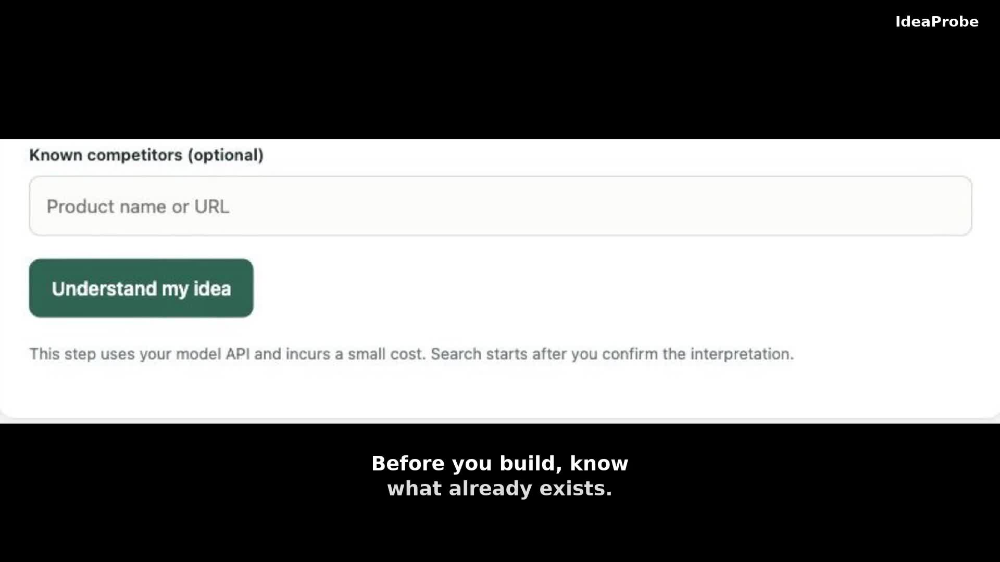

# IdeaProbe — 开源 AI 市场调研与竞品分析

[English](README.md) · [项目介绍页](https://pauline-zhang-star.github.io/IdeaProbe/zh/) · [供 AI 读取的项目摘要](https://pauline-zhang-star.github.io/IdeaProbe/llms.txt)

本地运行的产品前期调研工具：输入产品想法，确认 AI 的理解和检索词，搜索相关产品、采集真实评价，生成带来源引用的报告。使用你自己的模型及搜索 API key。

**用途：** 产品想法前期调研、竞品发现、App 用户评价分析、开源工具调研，以及独立开发者和创作者的市场研究。

## 45 秒介绍视频

[](https://github.com/pauline-zhang-star/IdeaProbe/blob/main/docs/assets/ideaprobe-demo-45s.mp4)

观看 45 秒英文介绍：确认想法、发现相关产品、检查采集证据，并查看带来源引用的报告。

## 功能

- **先确认理解：** 修改想法摘要、问题、目标用户、场景和检索关键词。先广泛发现产品，目标用户和场景用于评分，不作为排除产品的条件。
- **多源并行搜索：** 每个关键词同时查询所有已启用且可用的 Bing RSS、Tavily 和 Brave，合并去重并显示失败原因。候选少时，在预算内生成新关键词扩大搜索。
- **调查重点候选：** 默认深入调查前 10 个，可调整为 5 个或更少。其他候选保留评分及未入选原因，找到的产品不足目标数量时调查现有候选。
- **真实反馈：** 发现并核对 App Store、Google Play 和讨论链接。评论和讨论分别计数，不把宣传当作用户反馈，不编造缺失评价。
- **自选模型：** 理解、关键词和抽取与最终报告可分别选择 OpenAI、Anthropic Claude、Google Gemini 或支持 Chat Completions 和 JSON 输出的兼容服务。
- **本地记录与导出：** 处理进度、可展开报告卡片、本地历史记录、JSON 下载和浏览器打印为 PDF。
- **语言切换：** 根据浏览器首选语言默认选择中文或英文，也可手动切换。新报告使用所选界面语言，既有报告不自动翻译。

## 本地启动

需要 **Node.js 24+** 和 **Python 3.9+**。无需数据库、Docker 或云部署，没有需要安装的 Node 包依赖。

```sh
git clone https://github.com/pauline-zhang-star/IdeaProbe.git
cd IdeaProbe
python3 -m venv .venv
.venv/bin/python -m pip install -r requirements.txt
cp .env.example .env
```

在 `.env` 中设置 `PYTHON_BIN=.venv/bin/python`，然后启动：

```sh
npm start
```

打开 **http://localhost:3210/**，在右侧 API 配置中选择供应商、填写模型名称和自己的 API key，然后保存。Bing RSS 默认启用且无需搜索 key；Tavily 和 Brave 可按需配置。

理解/抽取与最终报告可使用不同供应商。同一供应商及地址共用已保存的 key。“已配置”表示检测到已保存的密钥，不代表已验证权限或额度。

Windows 安装依赖时使用 `.venv\Scripts\python.exe`，设置 `PYTHON_BIN=.venv/Scripts/python.exe`。可通过文件管理器复制配置模板，或在 PowerShell 执行 `Copy-Item .env.example .env`。

### 模型配置

| 供应商 | 接口 | 配置内容 |
| --- | --- | --- |
| OpenAI | Chat Completions | 模型 ID 和 OpenAI API key |
| Anthropic / Claude | 原生 Messages API | Claude 模型 ID 和 Anthropic API key |
| Google / Gemini | 官方 OpenAI 兼容接口 | Gemini 模型 ID 和 Gemini API key |
| OpenAI 兼容服务 | Chat Completions 与 JSON 输出 | API 基础地址、模型 ID 和服务 key |

自定义地址使用 HTTPS，本机服务允许 HTTP（`localhost` 或 `127.0.0.1`）。填写类似 `https://api.example.com/v1` 的基础地址，不要加 `/chat/completions`。模型权限和参数兼容性取决于所选服务。当前所有模型请求，包括自定义服务，都需要填写 key。

默认 OpenAI 模型为理解/抽取使用的 `gpt-6-luna` 和生成报告的 `gpt-6.1-sol`，可替换成自己账号可用的模型 ID。其他供应商需自行填写模型 ID。

密钥按供应商及接口地址保存到 `.data/search-settings.json`。切换服务不会沿用其他服务的 key，输入框不回显已保存的密钥；填写新 key 可替换。保存后对后续请求即时生效，无需重启。

也可以在 `.env` 配置 OpenAI 和搜索密钥：

```dotenv
OPENAI_API_KEY=
OPENAI_MODEL=gpt-6-luna
OPENAI_REPORT_MODEL=gpt-6.1-sol
TAVILY_API_KEY=
BRAVE_API_KEY=
PYTHON_BIN=.venv/bin/python
PORT=3210
DATA_DIR=.data
MODEL_MAX_OUTPUT_TOKENS=6000
MODEL_TIMEOUT_MS=180000
```

网页保存的设置优先于环境配置。网页正文读取使用 Tavily；未配置时保留搜索摘要，并显示读取限制。Bing 公开 RSS 入口可能不可用或返回相关性较低的结果。

## 调研流程

1. 输入想法、市场和语言代码，可填写已知竞品。
2. 点击“理解我的想法”，修改并确认理解及实际搜索关键词。
3. 设置产品搜索次数、评价入口搜索次数、页面数、token、评论数和目标产品数。
4. 广泛搜索，候选少时扩搜，评分并调查入选产品。
5. 采集实际可获得的评论和核实过的讨论，分析证据，生成报告并校验引用。
6. 展开报告卡片查看来源和采集覆盖，下载 JSON 或打印为 PDF。

评论拿到多少算多少。没有评论仍保留产品信息，不生成无证据的“实际用户反馈”。重点调查和采集覆盖最多显示 10 个入选产品，其他候选单独展示。

关闭网页不会取消任务。停止服务或关闭电脑会中断任务；重启后可从本地历史继续已确认的任务，复用已完成阶段。已请求但未保存的结果可能在重试时再次产生费用。

## 数据、费用与限制

- 任务保存到 `.data/<任务ID>/state.json`，同一目录保存证据和报告。当前没有公共数据库或跨用户缓存。
- 密钥和调研记录保存在本机，调研内容会发送给你选择的模型及搜索供应商，不发送给项目作者。
- 本地版无需向项目订阅付费，外部供应商可能按 API 请求收费。请求和 token 上限不是保证金额不超出的消费限制。
- 服务仅监听 `127.0.0.1`，没有账号认证，当前版本未准备好对公网提供服务。
- 无法保证搜索覆盖全网。排名是 AI 的相关性估计，不是客观市场表现；引用 ID 有效也不等于所有结论正确，请核对来源。
- App 评论采集使用非官方接口，可能失效或返回零条。讨论页面不是经过验证的购买评价。
- 托管订阅、支付、共享产品库及跨用户增量复用尚未实现。

## 开发

```sh
node --test tests/*.test.ts
python3 -m unittest discover -s tests -p 'test_*.py'
```

测试使用隔离临时数据和模拟供应商响应，不需要付费 API 请求。Claude、Gemini 及自定义接口的请求格式有自动测试；真实端到端调用需要对应供应商的有效密钥。

```text
app/          本地服务、界面、调研流程、供应商与文件存储
collectors/   App Store 和 Google Play 的 Python 评论采集器
tests/        流程、模型路由、搜索、语言与采集器测试
docs/         公开介绍页及检索元数据
.env.example  不含密钥的配置模板
```

## 许可证

采用 MIT 许可证，参见 [LICENSE](LICENSE)。

已采集到证据后发生超时，会自动用现有数据生成报告，列出超时和未完成步骤。报告生成也超时或无法生成有效的部分报告时，展示已有来源摘录，注明未经模型分析，不编造缺失结论。

总 token 预算的 30% 预留给证据分析与最终报告（至少 12,000，不超过总预算）。搜索与抽取会提前暂停，避免占用预留额度。点击“用已有结果生成报告”停止进一步搜索和采集，使用剩余额度分析已有反馈并生成报告；报告输入按额度缩减，保存的原始证据保留。完全没有模型额度时，才降级为注明未经分析的证据报告。

新任务默认总预算为 100 万 tokens：约 70 万用于调研，30 万预留给分析和报告，可自行调整。未完成报告保留所有步骤及报告栏目，明确状态和缺少内容的原因。

## 需求覆盖

确认来自用户原话的可编辑需求清单，检索计划覆盖不同需求维度。候选能力区分有证据支持、有证据不支持和未知，确认结论必须附来源原文。按需求的证据匹配度排序，保留部分匹配产品。候选数量足够但需求未覆盖或形态单一时，仍进行最多两轮补搜。独立补搜预算默认 20 次供应商请求，可调整。入选产品结合已读取产品页再次核实。报告显示能力覆盖表、证据与停止原因。此机制适用于软件、硬件和服务。

公开说明：[中文产品资料](https://pauline-zhang-star.github.io/IdeaProbe/zh/facts/)和 [Markdown 版本](https://pauline-zhang-star.github.io/IdeaProbe/zh/facts/index.md)。产品资料及 FAQ 结构化数据由 `docs/site-data.json` 生成，修改后运行 `node scripts/build-site.mjs`。
